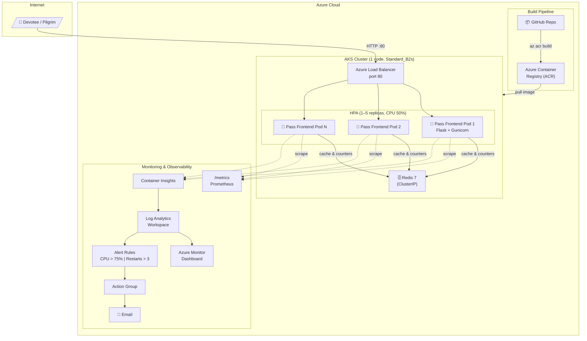

# MandirMitra — Bulk Pilgrim Darshan Pass Generator

A 2-tier microservices application that generates official PDF Darshan Passes and Pilgrim E-Passes for **Shri Mahakaleshwar Jyotirlinga (Ujjain)** at scale. Built with Python Flask and Redis, containerized with multi-stage Docker builds, and designed for deployment to **Azure Kubernetes Service (AKS)** with **Horizontal Pod Autoscaling (HPA)**.

---

## Architecture



---

## Endpoints

| Method | Path        | Description                                          | Response           |
|--------|-------------|------------------------------------------------------|--------------------|
| GET    | `/`         | HTML UI with single & bulk darshan pass forms        | text/html          |
| POST   | `/generate` | Generate single official Darshan Pass PDF            | application/pdf    |
| POST   | `/bulk`     | Generate multi-page PDF from pilgrim list or CSV     | application/pdf    |
| GET    | `/load`     | CPU load test endpoint (returns JSON summary)        | application/json   |
| GET    | `/stats`    | Real-time pass issuance and Redis cache statistics   | application/json   |
| GET    | `/health`   | Liveness probe (no Redis dependency)                 | text/plain 200     |
| GET    | `/ready`    | Readiness probe (requires Redis PING response)       | text/plain 200/503 |
| GET    | `/metrics`  | Prometheus exposition metrics                        | text/plain         |

### Query Parameters for `/load`

| Param    | Default | Description                                            |
|----------|---------|--------------------------------------------------------|
| `n`      | 50      | Number of passes to render (capped at `MAX_BATCH=200`) |
| `unique` | 0       | Set to `1` for synthetic random names to bypass cache  |

---

## Folder Structure

```
pass-generator/
├── frontend/
│   ├── app.py              # Flask application (all pass endpoints & PDF engine)
│   ├── requirements.txt    # Pinned Python dependencies
│   ├── Dockerfile          # Multi-stage build (python:3.12-slim)
│   └── .dockerignore
├── k8s/
│   ├── redis-deployment.yaml   # Redis Deployment + ClusterIP Service
│   ├── deployment.yaml         # Pass Frontend Deployment (ACR image)
│   ├── service.yaml            # LoadBalancer Service
│   └── hpa.yaml                # HorizontalPodAutoscaler (1–5 pods, target 50%)
├── loadtest/
│   ├── baseline.sh         # Light baseline traffic (~2 req/s for 2 min)
│   ├── loadtest.sh         # Ramped hey load test (~3 min)
│   ├── locustfile.py       # Locust load test alternative
│   └── LOADTEST.md         # Step-by-step load testing runbook
├── scripts/
│   ├── identity.sh         # Student identity verification script
│   ├── deploy.sh           # Deployment commands (print-only)
│   ├── cleanup.sh          # Teardown and cleanup commands
│   └── monitoring.md       # Azure Monitor & Container Insights guide
├── docker-compose.yml      # Local development (frontend + Redis)
├── .gitignore
└── README.md               # Complete project documentation
```

---

## Run Locally with Docker Compose

```bash
# Build and start both services
docker compose up --build -d

# Verify services and health status
docker compose ps

# Check image size
docker images | grep pass

# Test health and probe endpoints
curl http://localhost:8080/health
curl http://localhost:8080/ready
curl http://localhost:8080/stats

# Test CPU load endpoint
curl "http://localhost:8080/load?n=10&unique=1"

# Generate a sample Mahakaleshwar VIP Pass
curl -X POST -d "name=Hemangi Mourya&darshan_type=Sheeghra Darshan (VIP)&slot=07:30 AM - 09:30 AM&date=2026-11-05" \
     http://localhost:8080/generate -o pass.pdf

# Stop services
docker compose down
```

---

## Build and Push to ACR

```bash
# 1. Create Resource Group
az group create --name mandirmitra-rg --location eastus

# 2. Create Azure Container Registry (Basic SKU)
az acr create --resource-group mandirmitra-rg --name mandirmitraacr --sku Basic

# 3. Build image directly in ACR (no local Docker required)
az acr build --registry mandirmitraacr --image pass-frontend:v1 ./frontend
```

---

## Deploy to AKS

```bash
# 1. Create single-node AKS cluster with ACR attached
az aks create \
  --resource-group mandirmitra-rg \
  --name mandirmitra-aks \
  --node-count 1 \
  --node-vm-size Standard_B2s \
  --attach-acr mandirmitraacr \
  --generate-ssh-keys

# 2. Retrieve credentials
az aks get-credentials --resource-group mandirmitra-rg --name mandirmitra-aks

# 3. Update ACR image reference in deployment manifest
sed -i 's/<ACR_NAME>/mandirmitraacr/g' k8s/deployment.yaml

# 4. Apply all Kubernetes manifests
kubectl apply -f k8s/

# 5. Wait for Azure LoadBalancer External IP
kubectl get svc pass-frontend-svc -w
```

See `scripts/deploy.sh` for the complete command runbook.

---

## Load Testing & Horizontal Pod Autoscaling

See [loadtest/LOADTEST.md](loadtest/LOADTEST.md) for the complete terminal guide.

Quick start:

```bash
EXTERNAL_IP=$(kubectl get svc pass-frontend-svc -o jsonpath='{.status.loadBalancer.ingress[0].ip}')

# Terminal 1: Watch HPA
kubectl get hpa pass-frontend-hpa -w

# Terminal 2: Watch Pods
kubectl get pods -l app=pass-frontend -w

# Terminal 3: Run Baseline Traffic (2 min)
bash loadtest/baseline.sh $EXTERNAL_IP

# Terminal 3: Run Ramped Load Test (~3 min)
bash loadtest/loadtest.sh $EXTERNAL_IP
```

---

## Monitoring & Telemetry

See [scripts/monitoring.md](scripts/monitoring.md) for:
- Enabling Container Insights (metrics-focused to stay within free-tier quotas)
- Configuring Action Groups with email notification
- Alert rules: CPU > 75% (5 min) and pod restarts > 3 (10 min)
- KQL queries for custom Azure Monitor Dashboard tiles

---

## Cleanup

```bash
# Delete all resources in one command
az group delete --name mandirmitra-rg --yes --no-wait
```

---

## Design Decisions

### 1. Stateless In-Memory PDF Generation
The frontend writes zero files to local container storage. All PDF Darshan Passes are rendered in-memory using Python `io.BytesIO`. This makes every frontend pod completely stateless, allowing incoming requests to be distributed seamlessly across replicas by the Azure Load Balancer.

### 2. Redis Caching Tier (300s TTL)
Single passes are cached by the SHA-256 hash of `(name + darshan_type + slot + date)`. The 300-second TTL prevents duplicate rendering of repeat requests while keeping Redis memory footprint well within the 64 MB cap. Cache hits bypass ReportLab rendering entirely, yielding sub-10ms response times.

### 3. CPU-Bound Vector Geometry (`MAX_BATCH = 200`)
Each Darshan Pass includes intricate temple borders, sacred corner motifs, and radial geometric watermark rays. Under load testing (`/load?n=100&unique=1`), in-memory canvas calculations create authentic, measurable CPU load without external I/O bottlenecks, cleanly driving pod CPU above 50% to trigger HPA scale-up.

### 4. Quota-Preserving Logging (CRITICAL Only)
Application logging is configured to `logging.CRITICAL` and Gunicorn access logs stream to `/dev/null`. Container Insights is configured to omit stdout/stderr container logs. This guarantees Azure's free-tier Log Analytics quota (500 MB/day) is not exhausted during load tests.

### 5. Memory Limit Allocation (512 Mi)
The frontend container defines a memory request of `128Mi` and a limit of `512Mi` (4x request headroom). This headroom easily accommodates temporary in-memory allocations during 200-page bulk PDF generation before byte payloads are streamed to the client.

### 6. Tuned HPA Scaling Windows
- **Scale-up:** `stabilizationWindowSeconds: 0` — Pods scale up immediately when CPU exceeds 50% so auto-scaling is responsive during short load tests.
- **Scale-down:** `stabilizationWindowSeconds: 120` — A 2-minute delay before pod termination prevents flapping and ensures scale-down activity is captured in submission screenshots.

### 7. Single Worker Gunicorn Architecture
Running Gunicorn with 1 worker process and 4 threads ensures `prometheus_client` counters and histograms remain process-isolated and mathematically accurate, while Kubernetes HPA handles horizontal multi-replica concurrency.
